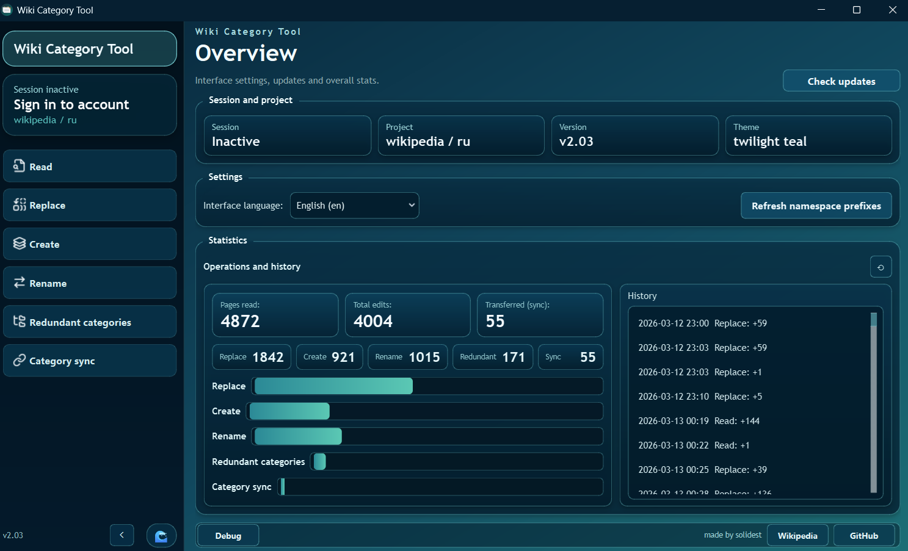
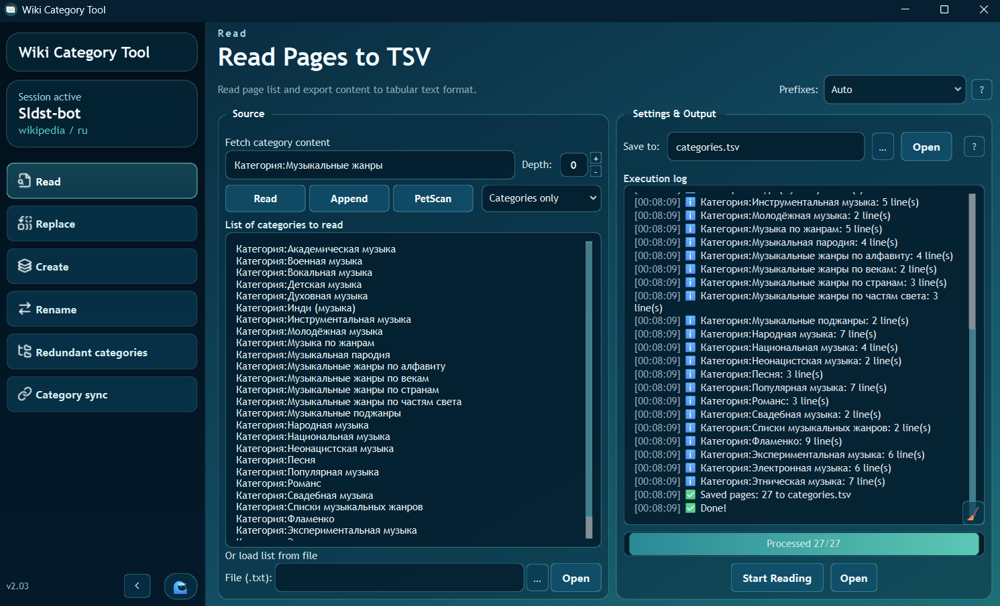
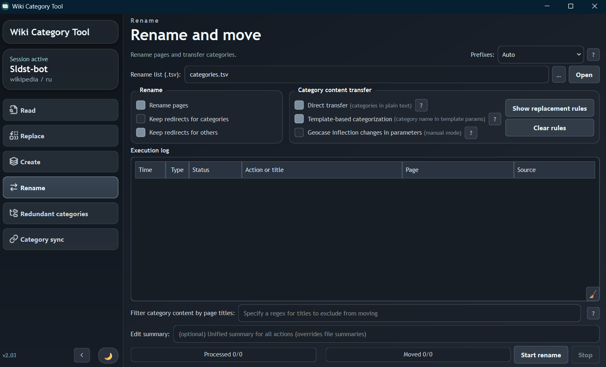
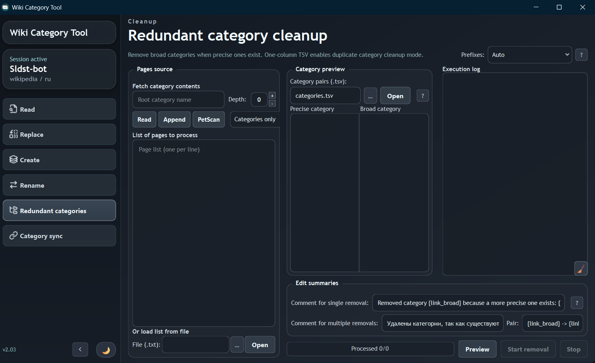
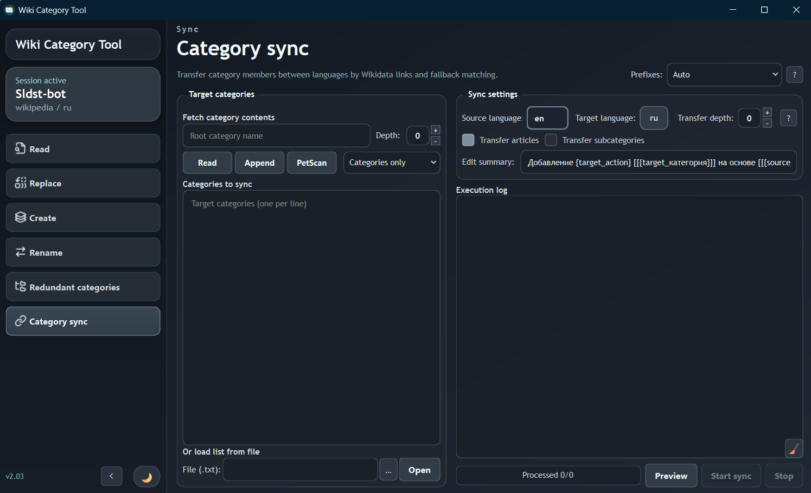

# Wiki Category Tool

> ## [In English](README_EN.md)

[](https://github.com/sc113/wiki-category-tool/releases/latest)
[](LICENSE)
[](https://www.python.org/)

Wiki Category Tool — десктоп-приложение на `PySide6` для пакетной работы со страницами и категориями Wikimedia через `pywikibot` и MediaWiki API.

Проект ориентирован на сценарии массовой обработки TSV:

- считывание списков страниц и подкатегорий;
- массовая перезапись существующих страниц;
- массовое создание отсутствующих страниц;
- переименование страниц с переносом категорий;
- удаление избыточных категорий;
- межъязыковая синхронизация категорий.

> [Скачать последнюю версию для Windows](https://github.com/sc113/wiki-category-tool/releases/latest) или следуйте инструкции ниже для запуска из исходного кода.

## Скриншоты

### Обзор и статистика операций



В обзоре учитываются сканирование, подготовка и связывание интервики. Сканирование считает обработанные категории, подготовка и связывание — успешные правки страниц и Wikidata.

<table>
  <tr>
    <td width="50%">
      <strong>Считывание страниц в TSV</strong><br>
      
    </td>
    <td width="50%">
      <strong>Переименование и перенос категорий</strong><br>
      
    </td>
  </tr>
  <tr>
    <td width="50%">
      <strong>Удаление избыточных категорий</strong><br>
      
    </td>
    <td width="50%">
      <strong>Межъязыковая синхронизация категорий</strong><br>
      
    </td>
  </tr>
</table>

---

## Основные возможности

- Авторизация в проектах Wikimedia через `pywikibot`, включая интерактивную двухфакторную авторизацию.
- Работа с пространствами имён и префиксами (`Авто` или принудительная нормализация к выбранному NS).
- Считывание содержимого страниц и категорий с экспортом в UTF-8 TSV.
- Массовая перезапись существующих и создание отсутствующих страниц.
- Переименование страниц с переносом прямых категорий и категорий в параметрах шаблонов.
- Предпросмотр и удаление широких категорий при наличии более точных.
- Удаление дубликатов целевых категорий по одноколоночному TSV.
- Межъязыковая синхронизация статей и подкатегорий через ссылки Wikidata и резервное сопоставление.
- Предпросмотр операций перед запуском записи.
- Логи выполнения, прогресс, статистика правок и история операций.
- Русский и английский интерфейс и несколько визуальных тем.

---

## Технические требования

- Python: `3.10+`
- ОС: Windows 10/11 — основной поддерживаемый и собираемый вариант
- Зависимости: `PySide6`, `pywikibot`, `requests`, `packaging`

Запуск из исходного кода на других операционных системах возможен, но основной целевой платформой остаётся Windows.

---

## Установка

```powershell
git clone https://github.com/sc113/wiki-category-tool.git
cd wiki-category-tool
python -m venv .venv
.\.venv\Scripts\Activate.ps1
python -m pip install --upgrade pip
python -m pip install -r requirements.txt
```

---

## Запуск

Из корня репозитория:

```powershell
python __main__.py
```

Если каталог репозитория доступен как пакет `wiki_cat_tool` из родительской директории:

```powershell
python -m wiki_cat_tool
```

`python main.py` использовать не рекомендуется из-за package-relative импортов.

---

## Форматы TSV

Рекомендуемая кодировка файлов — UTF-8 с BOM.

### Перезапись / Создание

```text
Title<TAB>Line 1<TAB>Line 2<TAB>...
```

- Первая колонка: заголовок страницы.
- Остальные колонки объединяются в конечный текст через переносы строк.

### Переименование

```text
OldTitle<TAB>NewTitle<TAB>Необязательный комментарий
```

- Третья колонка опциональна.
- Общий комментарий во вкладке может переопределить комментарий из TSV.

### Удаление избыточных категорий

Режим пар удаляет широкую категорию, если присутствует соответствующая точная:

```text
PreciseCategory<TAB>BroadCategory
```

Файл с одной колонкой включает режим удаления дубликатов категорий:

```text
CategoryToDeduplicate
```

---

## Вкладки интерфейса

- **Обзор** — состояние сессии, настройки интерфейса, обновления, статистика и история.
- **Считывание** — сбор страниц и подкатегорий, экспорт содержимого в TSV.
- **Перезапись** — массовое обновление существующих страниц из TSV.
- **Создание** — создание только отсутствующих страниц из TSV.
- **Переименование** — переименование и перенос категорий, включая параметры шаблонов.
- **Избыточные категории** — предпросмотр и удаление широких категорий или дубликатов.
- **Перенос категорий** — сканирование категорий, подготовка, синхронизация содержимого. Этапы доступны отдельно и последовательно с передачей списков. Для уже существующих категорий есть отдельная вкладка «Связывание интервики».

### Перенос категорий

В боковом меню три этапа объединены тонкой рамкой. На первом этапе «Далее: подготовка» передаёт текущий отобранный список прямо в таблицу второго этапа. Названия и текст категорий редактируются в этой таблице; обязательного промежуточного файла нет. Второй этап можно открыть отдельно и загрузить TSV.

Списки этапов хранятся отдельно: загрузка, сканирование и удаление строк на первом этапе сохраняют данные второго. Кнопка «Далее» заменяет список следующего этапа текущим. Языки находятся сверху. Файл задаётся строкой с подписью, путём, «…» и «Открыть», как в старых вкладках. «…» выбирает файл, «Открыть» загружает его в таблицу; открытие в редакторе доступно в меню поля пути. Экспорт находится в «Работе с таблицей». Общий рабочий файл — categories.tsv. Сканирование автоматически распознаёт список с одним названием на строку или сохранённый отчёт проверки. Глубина 0 считывает прямые подкатегории, каждый следующий уровень добавляет вложенность — как во вкладке «Считывание». Прогресс и пакеты обхода видны в логе. Параметры находятся справа от языков и поясняются кнопкой «?», а «Очистить всё» сбрасывает таблицу текущего этапа; действие можно отменить через Ctrl+Z. «Добавить список…» позволяет ввести названия вручную и добавить их к текущей таблице. Пустые строки и точные повторы исключаются; добавление можно отменить через Ctrl+Z. Проверка префиксов выполняется на исходном языке при сканировании. Открытие файла заменяет только список первого этапа. Меню экспорта предлагает отчёт с результатами и отдельный список для создания.

Укажите исходный язык, категорию и глубину обхода. Над таблицей последовательно расположены строки «Категория для считывания» с глубиной справа и «Список готовых категорий» с открытием файла. Категория относится к исходному языку; глубина по умолчанию — 0. «Считать» в шапке таблицы заменяет список найденными категориями; уровень исходной категории — 0. При необходимости включите её в список. По умолчанию обходятся все ветви. Параметр «Пропускать связанные с уровня» позволяет исключить категории с существующим аналогом и их ветви; 0 отключает это исключение.

Удалите лишние строки и нажмите «Сканировать». Считаются непосредственно включённые статьи основного пространства, имеющие через Wikidata существующую статью на текущем языке. Перенаправления и повторы не учитываются. «Очистить не найденные» удаляет только успешно проверенные строки с нулевым результатом. «Повторить ошибки» сканирует только неудачные строки, сохраняя успешные результаты. Пауза между запросами по умолчанию — 0,5 секунды; при ограничении API программа соблюдает Retry-After и снижает темп запросов.

После остановки «Продолжить сканирование» проверяет только незавершённые строки и ошибки. «Сбросить проверку» сохраняет список и очищает результаты для повторной проверки с нуля; Ctrl+Z отменяет сброс. Проверка выполняется пакетами по пять категорий, с общими запросами связей и страниц назначения.

Нажмите число в столбце «Доступно», чтобы открыть список найденных статей. Для уже связанной категории дополнительно показываются числа «Уже в категории» и «Можно добавить». Проверка текущего наполнения выполняется только при открытии этого окна; отчёты TSV прежнего формата поддерживаются.

«Экспорт TSV» сохраняет всю таблицу сканирования в один файл. Его можно снова открыть в сканировании или загрузить в подготовку: названия сохранятся, служебные столбцы не попадут в текст категории.

TSV подготовки сохраняется без строки заголовка:

```text
SourceCategory<TAB>CurrentLanguageCategory<TAB>Wikitext line 1<TAB>Wikitext line 2<TAB>...
```

Перевод названия и текст категории заполняются вручную в таблице или TSV; для существующих аналогов название подставляется автоматически при проверке связей. Столбцы начиная с третьего образуют текст **страницы категории**, а статьи будут добавлены при последующей синхронизации. Для новой категории требуется непустой текст. Таблицу второго этапа можно экспортировать в TSV.

Инструменты редактирования собраны под таблицей в рамке «Работа с таблицей»; там же раскрывается «Автозаполнение». Проверка и создание находятся ниже, переход к следующему этапу — отдельно справа. Исходный язык вводится вручную; текущий отображается отдельным значком и берётся из профиля.

В панели второго столбца задайте перевод с `{число}` или `{римская}`. Например, `Category:20th-century art` превращается в `Категория:Искусство 20 века` или `Категория:Искусство XX века`. Число, английский порядковый суффикс и римское обозначение распознаются автоматически; необязательный исходный образец ограничивает смешанный список одной серией. В предпросмотре видны подстановки для каждой строки; заполнить можно весь список или только выделенные строки. Неоднозначные числа и совпадающие названия пропускаются. Общий флажок «Заполнять только пустые ячейки» справа от вкладок столбцов применяется ко всем действиям автозаполнения; по умолчанию он выключен. Если в серии есть готовый перевод с тем же числом, шаблон предлагается автоматически. После заполнения снова проверьте список.

«Заполнить текст…» добавляет одинаковый текст в третий столбец всего списка или выбранных строк с учётом общего флажка пустых ячеек. Для копирования текста выберите ячейку третьего столбца и перетащите её нижний правый уголок по нужным строкам. Двойной щелчок по уголку заполняет ячейки ниже с учётом того же флажка. Del удаляет выбранные строки; во время редактирования ячейки он удаляет символы. После изменений нужна повторная проверка списка. Ссылки Wikidata подчёркнуты и открываются одним щелчком. Журнал операций и сведения о запросах также попадают в общий дебаг.

В панели третьего столбца «Первую строку → столбец» копирует текст первой строки во весь столбец с учётом общего флажка пустых ячеек. «Текст исходных категорий» загружает вики-текст зарубежных категорий из первого столбца для ручного перевода; загрузка также учитывает общий флажок пустых ячеек. После загрузки переведите и проверьте текст перед созданием.

«Проверить связи» определяет, что нужно создать, что уже существует без связи и что уже создано и связано. Пустые переводы и текст новых категорий показываются отдельными статусами «Нужен перевод» и «Нужен текст», а нужные ячейки подсвечиваются. «К незаполненной строке» помогает переходить между ними. Счётчики над таблицей разделяют готовые строки, уже связанные категории, незаполненные строки и ошибки проверки. Подробности выбранной строки видны под таблицей. Комментарий к созданию находится справа от кнопки «Запустить создание».

После заполнения снова проверьте список. После подтверждения создаются недостающие страницы и добавляются сайтлинки и недостающие метки Wikidata. Новые элементы получают P31 = категория в проекте Викимедиа (Q4167836). Существующий текст и занятые сайтлинки не перезаписываются; конфликты показываются как ошибки.

Во всех этапах переноса и связывании интервики языки находятся сверху; параметры стоят справа от языков в одной строке с разделителями. В подготовке и связывании интервики дополнительных параметров нет. Задержки между запросами регулируются автоматически. Инструменты таблицы расположены под ней в подписанной рамке; ниже — основные действия и прогресс. Счётчик и состояние показаны внутри полосы прогресса, справа находится «Остановить». «Экспорт TSV» и «Далее» стоят справа в нижнем ряду: можно сохранить результат или перейти к следующему этапу. Таблица и лог находятся в общей рамке; кнопка «Лог» расположена в её верхней строке вместе со счётчиками или краткой подсказкой. Следующие доступные действия выделены контуром, операции с пустой таблицей отключены. Нижний ряд прогресса и кнопка «Остановить» используют общий компонент на всех четырёх страницах. Лог открывается справа, регулируется по ширине и полностью скрывается, освобождая место таблице. При запуске обработки лог открывается автоматически. В сканировании и синхронизации «Префиксы» находятся справа в шапке. Комментарий к синхронизации расположен слева от кнопки запуска у правого края, а вкладки «Список категорий» и «Предпросмотр» переключают левую область без потери введённого списка и готовой таблицы.

Окно подтверждения показывает план: создание и связывание, связывание существующих категорий, обновление только меток и строки, которые будут пропущены. Ctrl+Z отменяет локальные правки, удаление строк и массовое заполнение во всех рабочих таблицах; Ctrl+Y повторяет отменённое действие. Редактор ячейки сохраняет собственную отмену текста. Запуск новой проверки или записи очищает историю соответствующей таблицы; правки на сайтах не отменяются через Ctrl+Z.

После остановки или частичного сбоя снова выполните проверку списка. «Запустить создание» создаёт отсутствующие категории и дополняет связи существующих одним запуском; готовые строки пропускаются. «Только связать» обрабатывает существующие страницы без создания отсутствующих. Проверка сразу открывает лог и показывает этапы запросов и прогресс. Все столбцы подготовки и связывания можно сортировать. В таблице видны QID обеих сторон. Создаваемые метки Wikidata включают локализованный префикс категории, комментарии к правкам Wikidata всегда на английском. Если сайтлинки уже существуют и меняются только метки, строка получает статус «Метки обновлены» и учитывается отдельно от новых связей. «Далее: синхронизация» передаёт все успешно связанные категории, включая ранее созданные, исходный язык и пары категорий с QID. Перед правками нужен обычный предпросмотр; переданные связи проверяются повторно и при изменении требуют новой проверки второго этапа. Сканирование и синхронизация используют общий поиск существующих статей через Wikidata.

Для отдельной операции с существующими страницами откройте «Связывание интервики» вне рамки «Перенос категорий». Она принимает TSV без заголовка: первый столбец — исходная категория, второй — категория на текущем языке. «Вставить из буфера» вставляет два столбца, скопированные из Excel или TSV; можно добавить строки вручную и заполнить переводы по тому же числовому шаблону. TSV второго этапа тоже подходит: дополнительные столбцы игнорируются.

Сначала проверьте список и подтвердите связывание. Если элемент Wikidata есть у одной категории, в него добавляются сайтлинк второй и недостающие метки. Если элементы совпадают, строка пропускается. Если элемента нет у обеих, создаётся новый с P31 = Q4167836. Все записи Wikidata используют текущий профиль, включая случаи, когда страницы уже созданы и требуют только связи. Страницы категорий на этой вкладке не создаются.

Пары с разными элементами попадают в отчёт: его можно сохранить в TSV, а команды `MERGE<TAB>новый QID<TAB>старый QID` — скопировать или сохранить для QuickStatements. Меньший QID сохраняется; повторные команды исключаются. Объединение выполняется пользователем через QuickStatements. Успешно связанные пары можно передать в синхронизацию содержимого кнопкой «Далее».

При открытии categories.tsv синхронизация использует целевой столбец из файлов переноса и сохраняет исходные пары; простой список целевых категорий читается из первого столбца.

В синхронизации столбцы идут в порядке: исходная категория, целевая категория, Wikidata. Если API Википедии ещё не видит недавно добавленный сайтлинк, QID проверяется непосредственно по Wikidata. Изменившаяся переданная связь показывается как ошибка с сохранением исходного названия.

---

## Конфиги и runtime-данные

Папка `configs/` создаётся автоматически и может содержать:

- `user-config.py`, `user-password.py` — настройки `pywikibot`;
- `pywikibot*.lwp` — cookie-файлы;
- `template_rules.json` — правила шаблонных замен;
- `update_settings.json` — настройки проверки обновлений;
- `apicache/` — кэш API и namespace-префиксов.

Эти файлы зависят от окружения и могут содержать данные авторизации. Не публикуйте и не добавляйте их в репозиторий.

---

## Структура проекта

- `gui/` — главное окно, вкладки, диалоги и виджеты.
- `workers/` — фоновые потоки операций.
- `core/` — API-клиент, namespace manager, локализация и конфигурация.
- `locales/` — словари интерфейса (`ru-RU.json`, `en-US.json`).
- `assets/` — ресурсы интерфейса и скриншоты.
- `configs/` — runtime-состояние, создаваемое при запуске.

---

## Сборка EXE для Windows

```powershell
python -m pip install pyinstaller
pyinstaller WikiCatTool.spec
```

Результат: `dist/WikiCatTool.exe`.

---

## Практические замечания

- Перед массовыми изменениями тестируйте операции на небольшом наборе страниц.
- Учитывайте локальные правила конкретного Wikimedia-проекта.
- Проверяйте предпросмотр и комментарии к правкам перед запуском.
- Убедитесь, что у учётной записи достаточно прав для выбранной операции.

---

## Лицензия

Проект распространяется под лицензией `GPL-3.0-or-later`. Полный текст доступен в файле [LICENSE](LICENSE).
